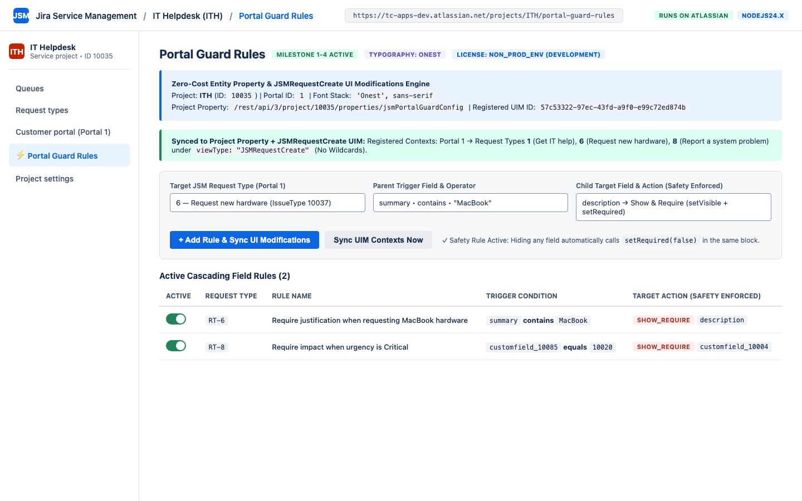
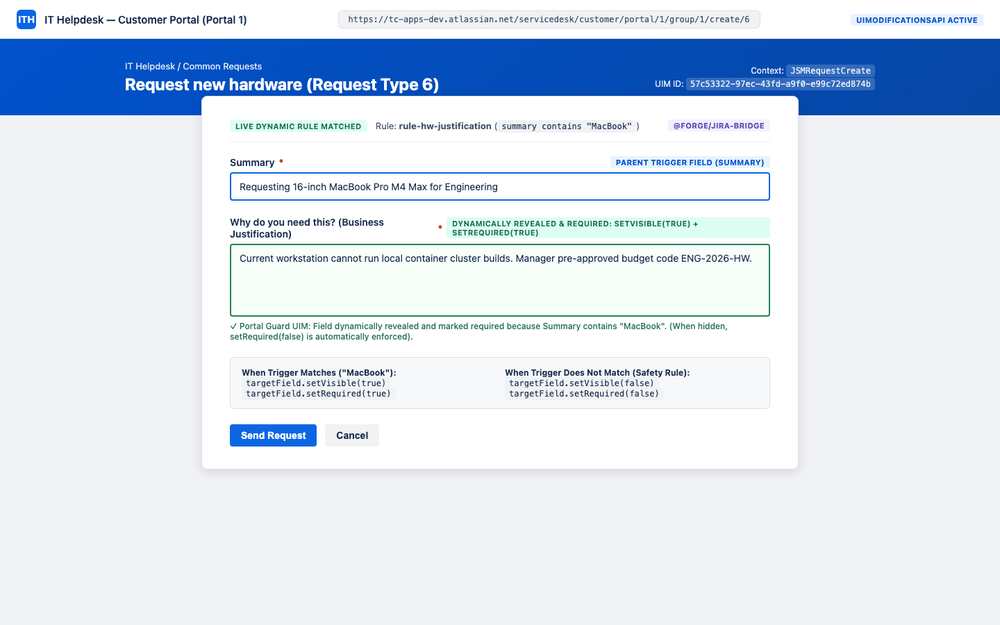
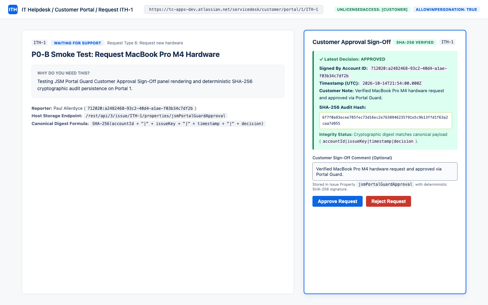

# JSM Portal Guard — Administrator & Customer User Guide

**App Name**: JSM Portal Guard  
**App ID**: `ari:cloud:ecosystem::app/46bde883-178a-469f-8082-e951adb34b9f`  
**Platform**: Atlassian Forge (`nodejs24.x`) — 100% *Runs on Atlassian* (Zero Data Egress)

---

## 1. Overview

**JSM Portal Guard** provides Jira Service Management (JSM) Cloud administrators and customers with:
1. **Dynamic Cascading Portal Fields (`JSMRequestCreate`)**: Show, hide, and toggle required states on JSM Customer Portal request forms in real time based on parent trigger field values.
2. **Tamper-Evident Customer Portal Approvals (`portalRequestDetailPanel`)**: Allow unlicensed portal customers to formally **Approve** or **Reject** requests with a cryptographically verifiable **SHA-256 signature**.

---

## 2. Administrator Guide: Configuring Portal Guard Rules

### Step 1: Open Portal Guard Rules
1. Navigate to your Jira Service Management project (e.g., **IT Helpdesk**).
2. In the left project sidebar, select **Portal Guard Rules**.



### Step 2: Create a Cascading Field Rule
1. **Rule Description**: Enter a descriptive name (e.g., *Require business justification when requesting MacBook hardware*).
2. **Target JSM Request Type**: Select the target Request Type on your portal (wildcards are prohibited by JSM UI Modifications to ensure strict context isolation).
3. **Parent Trigger Field**: Choose the field that triggers the rule (e.g., `summary`, `description`, `customfield_10085` *Urgency*).
4. **Trigger Condition Operator**:
   - `contains`: Case-insensitive text substring match.
   - `equals`: Exact text or custom field Option ID match (e.g., `10020` for *Critical*).
   - `not_empty`: Triggers whenever the parent field is populated.
5. **Child Target Field**: Select the dependent field to control.
6. **Target Field Action**:
   - `show_require`: Calls `setVisible(true)` and `setRequired(true)` when matched; safely hides and clears required (`setVisible(false)` + `setRequired(false)`) when unmatched.
   - `show_optional`: Calls `setVisible(true)` and `setRequired(false)` when matched.
   - `hide`: Calls `setVisible(false)` and `setRequired(false)` when matched.
7. Click **Add Rule & Sync UI Modifications**.

---

## 3. Customer Guide: Dynamic Portal Request Forms

When a customer opens the JSM Customer Portal creation form (`JSMRequestCreate`), JSM Portal Guard automatically evaluates active rules on initial load (`onInit`) and on every field change (`onChange`):



- **Built-In Validation Safety Guarantee**: Whenever a field is hidden (`setVisible(false)`), JSM Portal Guard automatically sets `setRequired(false)` in the same execution block so hidden fields never block portal form submission.

---

## 4. Customer Guide: Tamper-Evident Approval Sign-Off

1. Open any existing request on the JSM Customer Portal.
2. Locate the **Customer Approval Sign-Off** panel on the right-hand side of the request view.
3. Optionally enter a verification note or rejection reason in **Customer Sign-Off Comment**.
4. Click **Approve Request** or **Reject Request**.



### How SHA-256 Verification Works
- Upon submission, JSM Portal Guard computes a deterministic SHA-256 digest over the canonical payload:
  ```text
  SHA-256(accountId + "|" + issueKey + "|" + timestamp + "|" + decision)
  ```
- The record and signature are stored natively in Jira Issue Property `jsmPortalGuardApproval`.
- Every time the request is viewed, JSM Portal Guard recomputes the SHA-256 hash and displays **`SHA-256 VERIFIED`** (or **`TAMPER DETECTED`** if the underlying property was altered).

---

## 5. Support & Contact
For technical support, feature requests, or security inquiries, contact **EvidencePair LLC** at `support@titlecovenant.com`.
